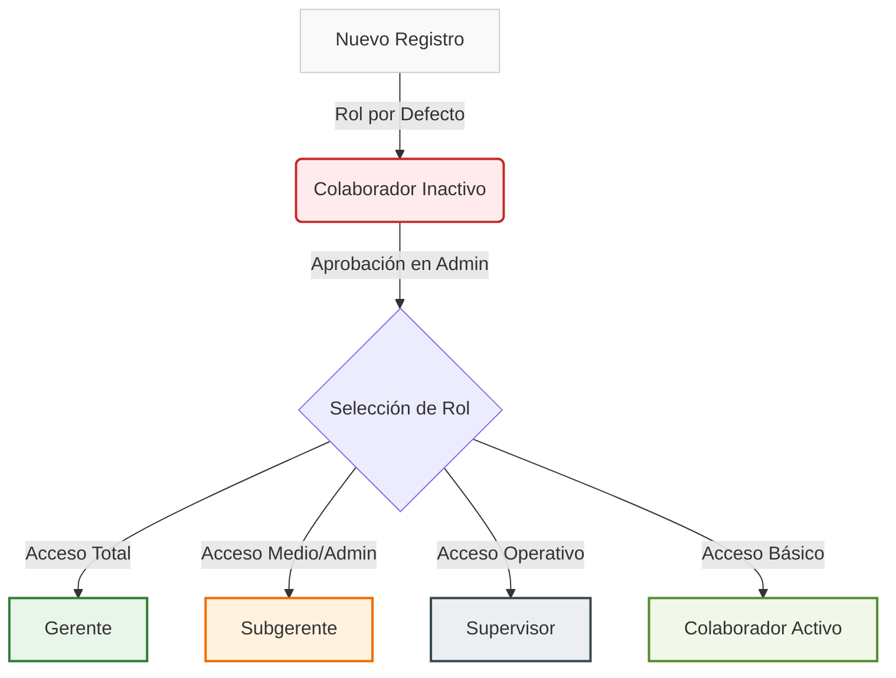
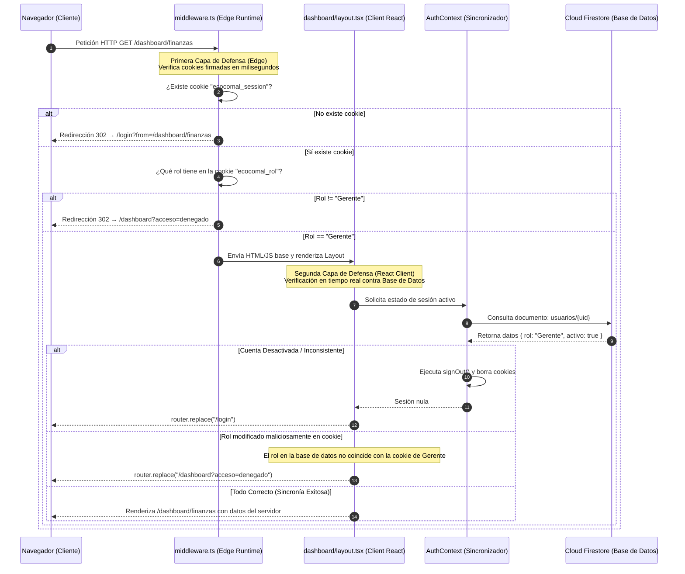
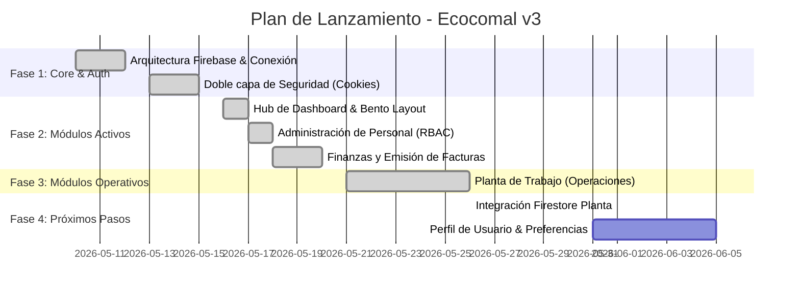

# Documentación Técnica Completa — Ecocomal v3
> **Sistema de Gestión Interno** · **Next.js 15 (App Router)** · **Tailwind CSS v4** · **Firebase Suite** · **Versión 3.1**

Esta documentación contiene la arquitectura detallada, el flujo de seguridad, los modelos de datos y la guía de desarrollo del sistema interno de **Ecocomal v3**. Ha sido estructurada para servir como manual de referencia técnica y guía de inducción para nuevos ingenieros.

---

## 1. Arquitectura General y Stack Tecnológico

El sistema está diseñado sobre una arquitectura moderna basada en componentes React, renderizado híbrido y seguridad en el borde (*Edge Routing*).

### 1.1. Tabla de Tecnologías

| Capa / Componente | Tecnología | Versión | Propósito / Rol en la Arquitectura |
| :--- | :--- | :--- | :--- |
| **Framework Base** | Next.js (App Router) | `15.x` | Routing ágil, Server/Client Components y Middleware Edge de alto rendimiento. |
| **Biblioteca UI** | React | `19.x` | Motor de renderizado con soporte para el nuevo gancho `use` y transiciones optimizadas. |
| **Estilos y Tokens** | Tailwind CSS | `v4.x` | Sistema de diseño basado en variables nativas CSS y compilación ultra rápida. |
| **Base de Datos** | Cloud Firestore | `11.x` | Base de datos NoSQL documental con sincronización en tiempo real para usuarios y facturas. |
| **Autenticación** | Firebase Auth | `11.x` | Control y cifrado de credenciales de usuario, recuperación e inicio de sesión seguro. |
| **Estado de Auth** | React Context API | `19.x` | Contexto global (`AuthContext`) que sincroniza cookies y estado en memoria. |
| **Iconografía** | Lucide React | *Latest* | Paquete de iconos vectoriales SVG optimizados y tipados para TypeScript. |
| **Tipado Estricto** | TypeScript | `5.x` | Compilación robusta y definición formal de modelos de datos para evitar errores en tiempo de ejecución. |

---

### 1.2. Árbol del Proyecto y Roles de Archivos

La estructura de archivos sigue la convención de Next.js App Router, aislando las rutas protegidas del flujo de autenticación pública:

```
/ (Raíz del proyecto)
├── DOCUMENTACION.md           # Resumen de especificaciones de desarrollo rápido
├── DOCUMENTACION_COMPLETA.md  # Guía completa de arquitectura y desarrollo
├── next.config.ts             # Configuración del compilador y del runtime de Next.js
├── tailwind.config.ts / css   # Tokens de diseño y extensiones visuales
├── middleware.ts              # Edge Guard: Primera capa de seguridad ultrarrápida
src/
├── app/
│   ├── layout.tsx             # Root Layout: Carga el AuthProvider y fuentes globales
│   ├── page.tsx               # Redirección raíz inicial (dirige a /login o /dashboard)
│   ├── globals.css            # Estilos globales y definiciones de Tailwind CSS v4
│   ├── (auth)/                # Grupo de Rutas Públicas (Excluidas del Middleware general)
│   │   ├── layout.tsx         # Layout con Suspense Boundary para búsqueda de params
│   │   ├── login/             # Página de Login (Autentica en Firebase y escribe cookies)
│   │   └── registro/          # Registro de cuentas y creación de perfil inactivo
│   └── dashboard/             # Grupo de Rutas Protegidas (Requiere login activo)
│       ├── layout.tsx         # Client Guard: Segunda capa de seguridad (RBAC) y Navbar
│       ├── page.tsx           # Hub de Módulos (Bento Grid adaptativo según rol)
│       ├── administracion/    # Módulo de Control de Personal (Solo Gerente / Subgerente)
│       ├── finanzas/          # Módulo de Caja y Facturación (Exclusivo Gerente)
│       └── planta/            # Módulo Operativo de Planta (Todos los roles - Control de inventario y movimientos)
├── context/
│   └── AuthContext.tsx        # Observer de Firebase Auth y sincronizador de cookies
├── lib/
│   └── firebase.ts            # Inicialización e instancias singleton de Firebase
└── types/
    └── index.ts               # Definición formal de tipos y contratos de datos
```

---

## 2. Modelo de Permisos y Matriz de Roles (RBAC)

La seguridad del sistema se rige mediante un Control de Acceso Basado en Roles (**RBAC**). Cada cuenta nueva se inicializa con el rol mínimo y con el estado `activo: false`.

### 2.1. Matriz de Acceso por Módulo

| Módulo del Sistema | Ruta Web | Gerente | Subgerente | Supervisor | Colaborador |
| :--- | :--- | :---: | :---: | :---: | :---: |
| **Hub / Dashboard** | `/dashboard` | ✅ | ✅ | ✅ | ✅ |
| **Administración de Personal** | `/dashboard/administracion` | ✅ | ✅ | 🔒 | 🔒 |
| **Planta de Trabajo (Operaciones)** | `/dashboard/planta` | ✅ | ✅ | ✅ | ✅ |
| **Finanzas y Facturación** | `/dashboard/finanzas` | ✅ | 🔒 | 🔒 | 🔒 |

> [!WARNING]
> **Bloqueo a nivel de Subgerente en Finanzas**: Aunque el Subgerente puede administrar el personal general, tiene restringido en su totalidad el acceso al módulo de Finanzas. Su acceso directo por URL está bloqueado y el botón en el Hub se visualiza desactivado (con opacidad reducida y badge de candado).

---

### 2.2. Descripción Detallada de los Roles



*   **Gerente (Rol Supremo - Propietario)**:
    *   Tiene control absoluto sobre la base de datos y la configuración del personal.
    *   Es el **único** rol facultado para visualizar reportes financieros, registrar ingresos y emitir facturas legales.
    *   Puede promover o degradar a cualquier usuario (incluidos otros Subgerentes) y activar o desactivar cuentas.
*   **Subgerente (Rol Administrativo Secundario)**:
    *   Apoyo en la gestión de personal. Puede cambiar roles de **Supervisores** y **Colaboradores**, así como activar sus cuentas.
    *   **Restricción de seguridad**: No puede modificar a usuarios con el rol de **Gerente** ni ascender a nadie al rol de Gerente.
    *   No tiene acceso a métricas financieras ni al formulario de facturación.
*   **Supervisor (Rol Operativo en Planta)**:
    *   Supervisa el trabajo en planta y los registros operativos.
    *   Tiene el módulo de administración y el de finanzas bloqueados.
*   **Colaborador (Rol de Campo / Planta)**:
    *   Acceso restringido a tareas y utilidades de planta específicas.
    *   Es el rol inicial al registrarse en el sistema.

---

## 3. Doble Capa de Protección de Rutas

Para garantizar que el sistema sea inmune a manipulaciones de cookies en el lado del cliente y que responda con la menor latencia posible, se ha implementado un esquema de seguridad de **doble capa**:

### 3.1. Arquitectura del Flujo de Autenticación y Autorización



### 3.2. Explicación de las Capas

1.  **Primera Capa (Edge Middleware)**:
    *   **Cuándo actúa**: En la petición HTTP inicial (antes de cargar React, Next.js o el DOM).
    *   **Cómo actúa**: Analiza los encabezados de la petición en busca de las cookies `ecocomal_session` y `ecocomal_rol`.
    *   **Beneficio**: Bloquea de inmediato a bots o peticiones no autorizadas sin consumir recursos de renderizado ni ancho de banda de Firebase.
2.  **Segunda Capa (React / Firebase SDK)**:
    *   **Cuándo actúa**: En la hidratación del cliente, una vez que la página carga.
    *   **Cómo actúa**: El `AuthContext` monta un observador `onAuthStateChanged` que consulta a Cloud Firestore como la única fuente de verdad.
    *   **Beneficio**: Protege el sistema si un usuario edita manualmente las cookies en las herramientas de desarrollo de su navegador. Si el rol en la cookie difiere del rol almacenado en Firestore, el sistema destruye la sesión del cliente de inmediato.

---

## 4. Esquemas de Base de Datos (Cloud Firestore)

La base de datos se organiza de manera no relacional utilizando colecciones raíz optimizadas para lecturas rápidas y consistencia transaccional.

### 4.1. Colección `usuarios`

Cada documento en esta colección utiliza como ID único (`doc.id`) el **UID** del usuario generado por Firebase Authentication.

```typescript
interface UsuarioFirestore {
  nombre:   string;     // Nombre completo del empleado
  email:    string;     // Correo electrónico registrado
  rol:      Rol;        // "Gerente" | "Subgerente" | "Supervisor" | "Colaborador"
  activo:   boolean;    // Control de acceso. Si es false, se le niega la sesión.
  creadoEn: Timestamp;  // Fecha de registro en el servidor
}
```

*Ejemplo de Documento:*
```json
{
  "nombre": "Sofia Alvarez",
  "email": "salvarez@ecocomal.com",
  "rol": "Subgerente",
  "activo": true,
  "creadoEn": "2026-05-19T22:15:30Z"
}
```

---

### 4.2. Colección `facturas`

Colección de registro fiscal. Cada documento se genera con un ID aleatorio auto-creado por el cliente de Firestore (`addDoc`).

```typescript
interface FacturaFirestore {
  nit:            string;    // NIT del cliente (o "CF" para Consumidor Final)
  razonSocial:    string;    // Nombre fiscal o denominación social
  direccion:      string;    // Dirección fiscal registrada
  item:           string;    // Línea de producto vendida
  cantidad:       number;    // Cantidad de productos (unidades físicas)
  precioUnitario: number;    // Precio unitario con impuesto incluido en Quetzales (Q.)
  subtotal:       number;    // Base imponible libre de IVA (Total / 1.12)
  iva:            number;    // Impuesto al Valor Agregado del 12% (Total - Subtotal)
  total:          number;    // Monto final facturado (Cantidad * PrecioUnitario)
  emitidoEn:      Timestamp; // Marca de tiempo del servidor al momento de la firma
  emitidoPor:     string;    // UID del Gerente que firmó la factura
}
```

---

### 4.3. Reglas de Cálculo de Impuestos (SAT Guatemala)

En cumplimiento con el **Régimen General del IVA en Guatemala**, el precio de venta al público ya incluye el impuesto del 12%. El desglose financiero en el módulo de Finanzas sigue rigurosamente las siguientes ecuaciones matemáticas:

$$\text{Total} = \text{Cantidad} \times \text{Precio Unitario}$$

$$\text{Subtotal (Base Imponible)} = \frac{\text{Total}}{1.12}$$

$$\text{IVA Retenido (12\%)} = \text{Total} - \text{Subtotal}$$

> [!IMPORTANT]
> Los cálculos de subtotal e IVA se redondean y almacenan con una precisión de **dos decimales** (`parseFloat(valor.toFixed(2))`) para evitar inconsistencias de redondeo de punto flotante en las sumas acumuladas de caja.

### 4.4. Colecciones de Planta y Producción

Las siguientes colecciones gestionan el módulo de operaciones:

- **`inventario_stock`**: Documentos con ID igual al nombre del modelo (ej. `Ecocina`). Contienen un campo `cantidad` numérico actualizado mediante transacciones atómicas (`increment()`).
- **`inventario_movimientos`**: Registro inmutable de cada entrada y salida. Campos: `fecha`, `hora`, `modelo`, `cantidad`, `observaciones`, `tipo` ("entrada" o "salida").
- **`productos_recetas`**: Catálogo de BOM (Bill of Materials) para producción. Campos: `nombre`, `descripcion`, `insumos` (array de objetos `{nombre, cantidadReq, unidad}`).
- **`tareas_planta`**: Tareas asignadas al personal. Campos: `empleadoId`, `descripcion`, `prioridad`, `completada`, `fecha`, `creadoPor`.

---

## 5. Políticas de Seguridad de Firestore (Security Rules)

El acceso a la base de datos está restringido a nivel del servidor mediante políticas declarativas en Firestore. Ningún cliente puede eludir estas reglas, independientemente del código front-end ejecutado.

```javascript
rules_version = '2';
service cloud.firestore {
  match /databases/{database}/documents {

    // Reglas para la colección de Usuarios
    match /usuarios/{uid} {
      // Cualquier usuario autenticado puede leer su propio perfil
      allow read: if request.auth != null && request.auth.uid == uid;
      
      // Auto-registro: Permite crear el documento inicial si y solo si
      // se registra con el rol más bajo (Colaborador) y en estado inactivo.
      allow create: if request.auth != null && request.auth.uid == uid
                    && request.resource.data.rol == "Colaborador"
                    && request.resource.data.activo == false;
      
      // Modificaciones: Únicamente permitidas a cuentas que tengan rol de Gerente
      allow update: if request.auth != null &&
        get(/databases/$(database)/documents/usuarios/$(request.auth.uid)).data.rol == "Gerente";
        
      // Eliminaciones: Bloqueadas por completo para preservar trazabilidad de auditorías
      allow delete: if false;
    }

    // Reglas para la colección de Facturas
    match /facturas/{facturaId} {
      // Lectura y creación: Acceso exclusivo para usuarios con el rol de Gerente
      allow read, create: if request.auth != null &&
        get(/databases/$(database)/documents/usuarios/$(request.auth.uid)).data.rol == "Gerente";
        
      // Modificación y Eliminación: Bloqueado absoluto. Las facturas son inmutables.
      allow update, delete: if false;
    }

    // Reglas para colecciones de Planta (Stock, Movimientos, Recetas, Tareas)
    match /inventario_stock/{modelo} {
      allow read, write: if request.auth != null;
    }
    match /inventario_movimientos/{movId} {
      allow read, create: if request.auth != null;
      allow update, delete: if false; // Los movimientos son inmutables
    }
    match /productos_recetas/{recetaId} {
      allow read, write: if request.auth != null;
    }
    match /tareas_planta/{tareaId} {
      allow read, write: if request.auth != null;
    }
  }
}
```

---

## 6. Sistema de Diseño Visual "Eco-Industrial Premium"

El sistema visual de Ecocomal v3 se basa en una estética **limpia, sofisticada y de alta legibilidad**, inspirada en la sostenibilidad de los proyectos ecológicos combinada con la sobriedad industrial.

### 6.1. Tokens de Color y Estilos CSS

El diseño emplea Tailwind CSS v4 para establecer una paleta de color armónica y de alto contraste:

| Token Visual | Selector / Clase | Muestra / Propósito de Uso |
| :--- | :--- | :--- |
| **Fondo Principal** | `bg-stone-50` | Fondo general de todas las vistas del dashboard para reducir fatiga visual. |
| **Fondo Tarjetas** | `bg-white` | Contenedores limpios, tarjetas Bento y secciones del formulario. |
| **Bordes sutiles** | `border-stone-200/60` | Líneas de división finas para delimitar áreas sin sobrecargar la vista. |
| **Verde Bosque (Eco)** | `bg-emerald-800` | Botones de acción principales, toggles activos y elementos de marca. |
| **Verde Suave (Éxito)** | `bg-emerald-50 text-emerald-800` | Alertas de éxito y badge de usuario Gerente. |
| **Naranja Cobre** | `bg-orange-50 text-orange-700` | Resaltado de impuestos (IVA), badges de Subgerencia e indicadores de atención. |
| **Tipografía** | `font-sans` (Inter / Outfit) | Letra de alta legibilidad con tracking cerrado (`tracking-tight`) para títulos. |

---

### 6.2. Micro-interacciones y Animaciones

El dinamismo del sitio se logra mediante transiciones sutiles que guían la atención del usuario sin distraer:

*   **Efecto Bento-Grid Elevación**:
    ```postcss
    /* Tarjeta del Hub Principal */
    .modulo-card {
      @apply transition-all duration-300 hover:shadow-xl hover:-translate-y-1 hover:border-emerald-100;
    }
    ```
*   **Transición de Botón Primario**:
    ```postcss
    .btn-primary {
      @apply bg-emerald-800 hover:bg-emerald-700 active:scale-[0.98] transition-all duration-200;
    }
    ```
*   **Esqueleto de Carga Pasiva (Skeletons)**:
    ```postcss
    .skeleton-box {
      @apply animate-pulse bg-stone-200 rounded-2xl;
    }
    ```
*   **Efecto de Desplazamiento en Toggles**:
    Transiciones fluidas de `duration-300` para cambiar el estado activo del personal mediante switches interactivos.

---

## 7. Roadmap y Estado Actual de Módulos

El desarrollo de Ecocomal v3 se divide en fases modulares. A continuación se presenta el avance y la prioridad de los entregables:



### 7.1. Estado de Módulos

1.  **Acceso General (`/dashboard`)** — **[100% COMPLETADO]**
    *   Bento layout adaptativo según el rol de la sesión.
    *   Observadores en tiempo real que previenen pantallas de carga infinitas.
2.  **Administración de Personal (`/dashboard/administracion`)** — **[100% COMPLETADO]**
    *   Tabla interactiva de control de usuarios.
    *   Buscador dinámico en cliente.
    *   Toggles instantáneos de activación y menús desplegables para re-asignación de roles.
3.  **Finanzas (`/dashboard/finanzas`)** — **[100% COMPLETADO]**
    *   Panel de control con indicadores clave de rendimiento (KPIs).
    *   Historial en tiempo real de facturas emitidas.
    *   Formulario de emisión de facturas con desglose automático de IVA (SAT GT).
4.  **Planta de Trabajo (`/dashboard/planta`)** — **[100% COMPLETADO]**
    *   Monitor de stock en tiempo real para los 4 modelos del catálogo oficial.
    *   Sistema de registro de Entradas (producción) y Salidas (despacho a campo) con historial cronológico.
    *   KPIs dinámicos: Total en Bodega, Entradas del día y Despachos del día.
    *   Alerta visual de bajo stock (< 5 unidades) con badge ámbar por modelo.
    *   Validación de stock insuficiente al intentar registrar una salida mayor al disponible.

---

## 8. Módulo: Planta de Trabajo — Arquitectura Técnica

### 8.1. Ruta y Acceso

| Atributo | Valor |
| :--- | :--- |
| **Ruta** | `/dashboard/planta` |
| **Archivo** | `src/app/dashboard/planta/page.tsx` |
| **Acceso** | Todos los roles (Gerente, Subgerente, Supervisor, Colaborador) |
| **Dependencias externas** | `lucide-react` · `next/navigation` |
| **Conexión Firebase** | Colecciones: `inventario_stock`, `inventario_movimientos`, `productos_recetas`, `tareas_planta` |

### 8.2. Catálogo Oficial de Modelos

El módulo trabaja con el catálogo real de productos de Ecocomal. Los modelos son constantes de tipo `Modelo[]` definidas en el mismo archivo:

| ID interno | Nombre comercial | Descripción |
| :--- | :--- | :--- |
| `ecocina` | **Ecocina** | Cocina ecológica estándar de leña |
| `ecoplanchasuperior` | **EcoPlancha Superior** | Plancha metálica de alta eficiencia |
| `ecoplanchahibrida` | **Ecoplancha Híbrida** | Plancha combinada leña/gas |
| `ecocomal` | **Ecocomal** | Comal ecológico de barro refractario |

### 8.3. Modelo de Estado (Firestore Real-time)

El módulo utiliza observadores en tiempo real (`onSnapshot`) para sincronizar el estado global con Cloud Firestore:

- **Stock Actual**: Se lee desde `inventario_stock` mapeado por ID de modelo.
- **Movimientos**: Se lee desde `inventario_movimientos` y se usa para el historial y cálculo de KPIs.
- **Ajustes y Tareas**: Conectado a `productos_recetas` y `tareas_planta`.

Los tipos de TypeScript para estas estructuras se encuentran globalmente exportados en `src/types/index.ts`.

### 8.4. Lógica de Movimientos (Transacciones Atómicas)

Al confirmar el formulario de la columna derecha:

1.  **Validación**: Si `tipo === "salida"` y `cantidad > stockActual`, se bloquea en cliente.
2.  **Mutación de stock**: Se actualiza el documento en `inventario_stock` utilizando el operador `increment()` de Firestore para garantizar atomicidad y evitar *race conditions*.
3.  **Inserción en historial**: Se hace un `addDoc` en `inventario_movimientos` y gracias a la suscripción `onSnapshot`, la UI se actualiza inmediatamente para todos los usuarios conectados.

### 8.5. KPIs — Cálculo Dinámico

Los tres KPIs del encabezado se calculan mediante `useMemo` a partir de los datos en tiempo real de Firestore, filtrando por la fecha actual:

```typescript
// Total de unidades físicas disponibles en bodega
const totalBodega = useMemo(
  () => stock.reduce((acc, s) => acc + s.cantidad, 0),
  [stock]
);
// ... calculo similar para entradasHoy y salidasHoy
```

### 8.6. Regla de Bajo Stock

```typescript
const STOCK_BAJO = 5; // Umbral configurable

// En la tabla de stock: muestra badge ámbar si la cantidad cae por debajo
{item.cantidad < STOCK_BAJO && (
  <span className="... text-amber-700 bg-amber-50 ring-1 ring-amber-200/60 ...">
    <AlertTriangle ... /> Bajo Stock
  </span>
)}
```

---
*Ecocomal v3.1 · Sistema de Gestión Interno · © 2026*
